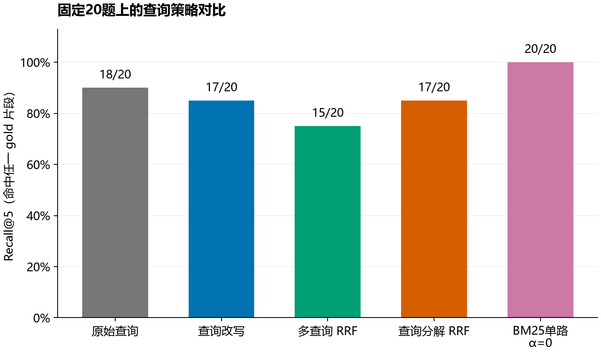
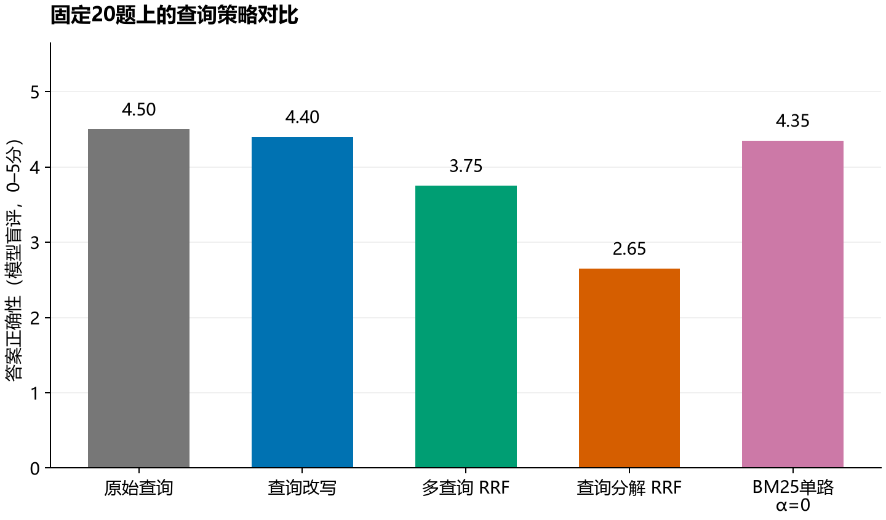
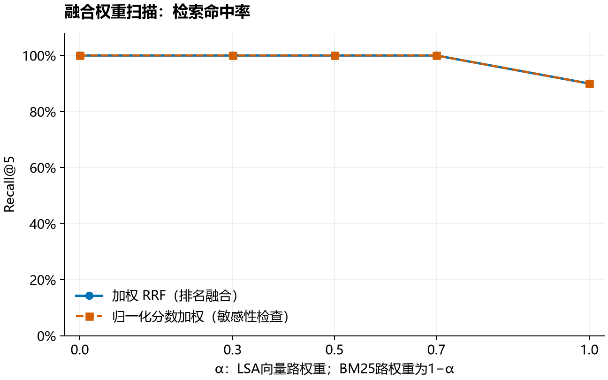
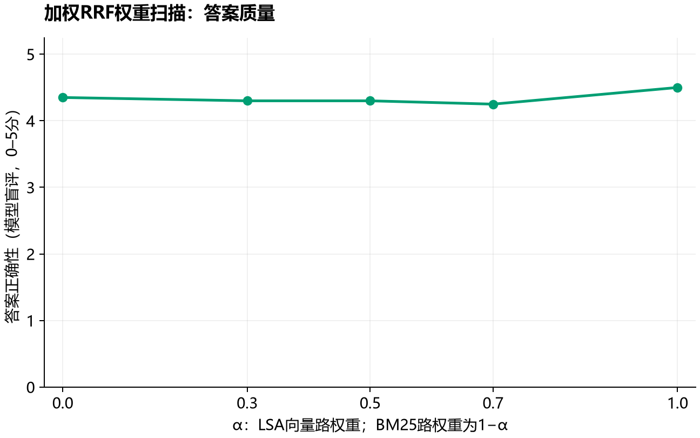

# T3 检索前查询优化与融合实验报告

## 任务与结论

本实验对应课程实践T3及课件9.6 p39–40、9.2.2 p15。实现大模型查询改写、多查询、查询分解，以及RRF结果融合，在固定20题上比较检索与答案质量。

原始查询Recall@5为90.0%。查询改写相对基线变化-5.0个百分点；多查询 RRF相对基线变化-15.0个百分点；查询分解 RRF相对基线变化-5.0个百分点。因此不能声称查询改写一定有效。按“先Recall、再正确性”的规则，加权RRF扫描选中α=0，Recall@5为100.0%、答案正确性模型评分为4.35/5。α=0是纯BM25端点，不是非零混合。这个选择基于同一小评测集，属于探索性结果，不是独立测试集上的最优保证。

原始查询的答案评分为4.50/5，优先召回选出的配置并未提高这一评分。因此本次不能总结为“融合同时提高了检索和答案”。若优先答案评分，扫描中的最高值反而是α=1、4.50/5，体现了不同目标的取舍。

## 实验控制

- 数据来自固定的23篇学院相关资料，202个片段；切分650字符、重叠120字符。使用仓库正式20题，L1–L4各5题，gold片段均在本机索引中存在。
- 固定原有字符TF-IDF（1–4元组）+64维LSA、归一化及FAISS检索。此向量路是统计降维表示，不冒充神经嵌入模型。原有数字/英文移除规则保持不变，避免同时更换索引变量。
- BM25为新增的融合检索路，中文单字与双字词元、完整数字和英文标识；k1=1.5，b=0.75，不使用标准答案设计词表。
- 单路取前20候选，最终统一返回前5个不重复片段；多查询/子查询并行执行检索、按同一RRF常数60融合。
- 本地qwen3:4b-instruct，temperature=0.2、seed=42、上下文8192、输出上限768 token；各最终回答使用相同的证据约束与引用提示。查询规划与评分temperature=0。
- 为节省重复调用，一个只看原问题的规划调用同时产生三种查询计划。单事实问题不强行分解；复合问题拆成不同子意图。标准答案不进入查询规划或答案生成。
- 查询分解先分别检索，再基于最终同一批top-5证据生成各子问题短答，最后综合。短答不能补充top-5以外事实。这一策略多一个子答案生成阶段，不能解释成零成本改进。
- 重新运行全部20题，不复用仓库中尚未补齐的T1结果。180个逻辑回答条件中有44个命中完整请求缓存；相同原问题、上下文及参数对应同一个输出，不是多次独立采样。

## 指标与评分

Recall@5严格按作业FAQ：任一gold片段在前5块中即记该题命中。另报gold覆盖比例，避免跨片段问题“只找到一块就看似成功”。字符ROUGE-L为次要词面指标，不用它替代复杂问答正确性。

正确性由同一Qwen进行LLM-as-Judge盲评：隐藏策略名、按固定种子打乱候选顺序，以仓库提供的参考答案为依据，按0–5分评价结论、条件及完整性。完全相同的答案只评一次并将分数共享给对应条件，避免同一文本因位置产生虚假差异。实际gold由仓库的助手辅助标注，尚无独立教师/学生审核声明；本实验评分也不冒称独立人工评分。自评偏差、小样本和单次运行限制仍存在。

## 策略对比

| 策略 | 命中题数 | Recall@5 | gold覆盖 | 正确性0–5 | 字符ROUGE-L | 截断数 |
| --- | --- | --- | --- | --- | --- | --- |
| 原始查询 | 18/20 | 90.0% | 80.4% | 4.50 | 0.230 | 4 |
| 查询改写 | 17/20 | 85.0% | 75.4% | 4.40 | 0.228 | 4 |
| 多查询 RRF | 15/20 | 75.0% | 70.4% | 3.75 | 0.251 | 4 |
| 查询分解 RRF | 17/20 | 85.0% | 75.4% | 2.65 | 0.280 | 0 |
| BM25单路 α=0 | 20/20 | 100.0% | 82.9% | 4.35 | 0.251 | 4 |

正式题目的表述通常已包含文件名称、年份及明确子意图。改写有时删弱关键词，或使多路排名反复强调某一子意图，导致其他证据被挤出前5。因此本组数据不支持“查询越多越好”。融合路保留BM25精确词面匹配，有机会弥补LSA降维及移除年份造成的不足；具体仍应逐题检查证据。

一个可核对的负面案例是q011：子问题短答已给出GPA门槛3.0，但最终综合回答只说2.9未达标，漏掉了用户要求的明确规则与比较过程，模型评分从原始查询的5分降到2分。这提示分解链路除了检索，还可能在综合时丢失必要条件。另一个评分边界是q007：两种答案都给出了正确申请日期，但评分器给原始查询5分、分解4分。因此对0.1至0.25分的小差异不应作强结论，仍需独立人工复核。

严格片段编号也有边界：补充案例c03原始检索拿到的p00191已包含辅修日期，而gold只标了与其重叠的p00190，导致编号覆盖被低估。原始答案本轮已答对，不应将优化后编号覆盖增加写成“补齐缺失日期”。主表统一遵守作业的gold ID口径，案例则另行核对实际证据，详见案例报告。

## 融合权重实验

加权RRF使用 s(d)=α/(60+r向量(d))+(1−α)/(60+rBM25(d))；某路未召回该片段时，该项为0。α=1只使用原向量路，α=0只使用BM25。各路候选内去重，按片段ID确定并列次序。

为避免把“RRF”与题目示例中的分数加权混为一谈，另做min-max归一化后 s(d)=α·dense_norm(d)+(1−α)·bm25_norm(d) 的检索敏感性检查。它不叫RRF；其答案未另行生成，表中只报告检索指标。

| α | RRF Recall@5 | RRF gold覆盖 | RRF正确性0–5 | 分数加权 Recall@5 |
| --- | --- | --- | --- | --- |
| 0 | 100.0% | 82.9% | 4.35 | 100.0% |
| 0.3 | 100.0% | 87.9% | 4.30 | 100.0% |
| 0.5 | 100.0% | 87.9% | 4.30 | 100.0% |
| 0.7 | 100.0% | 89.2% | 4.25 | 100.0% |
| 1 | 90.0% | 80.4% | 4.50 | 90.0% |

最佳配置按Recall@5、正确性模型均分、gold覆盖依次比较。曲线若出现平台，不能凭相同命中率断言唯一最佳权重；每题占5个百分点，20题不足以支持“显著提升”的统计结论。

BM25单路（α=0）已达到相同Recall@5，因此不能声称混合检索在命中率上进一步超过纯BM25；权重的取舍还需看答案质量和证据覆盖。

## 案例与边界

完整中间查询、原始及优化后召回片段、gold证据、最终答案见《T3案例分析.md》。额外口语化挑战题与主20题分开存储，所有挑战结果都保留，不混入主表、不冒充独立泛化测试。它们用于展示查询优化适用条件，而不是掩盖正式题上的负优化。

本轮共32个最终回答触及输出上限，表中已列出各策略截断数；截断输出按实际文本评分，没有静默替换。引用编号合法性也单独记录，但编号合法不能证明内容有依据。

## 复现与交付

代码：src/t3_core.py、src/run_t3.py；补充案例：tools/run_t3_challenges.py。结果：results/t3/内的查询计划、检索排名、180条答案、20份盲评分配与评分、逐题指标和汇总；四张PNG曲线在figures/。具体命令见README_T3.md。

核心局限：原有LSA向量路不是神经稠密模型；评测集及金标仍需提交者复核；同模型生成与自评存在偏差；权重在同一小集合上探索；无独立多次采样或显著性检验。本次不代替T7完整忠实度、幻觉率与失败归因评估。

## 方法来源与辅助说明

- RRF原论文：[Cormack等，SIGIR 2009](https://research.google/pubs/reciprocal-rank-fusion-outperforms-condorcet-and-individual-rank-learning-methods/)。本实验采用其排名倒数思想的加权版本。
- BM25公式参考：[Stanford Introduction to Information Retrieval](https://nlp.stanford.edu/IR-book/html/htmledition/okapi-bm25-a-non-binary-model-1.html)。中文词元方案为本实现选择。
- 结构化查询输出：[Ollama Structured Outputs](https://ollama.com/blog/structured-outputs)。
- 基础代码和正式评测数据来自sunfeiyu666/LLM-RAG，起点提交53c4c7b。新增实现、实验整理和报告有大模型辅助；本地模型真实运行，未编造结果。提交者应复核并注明辅助与来源。
