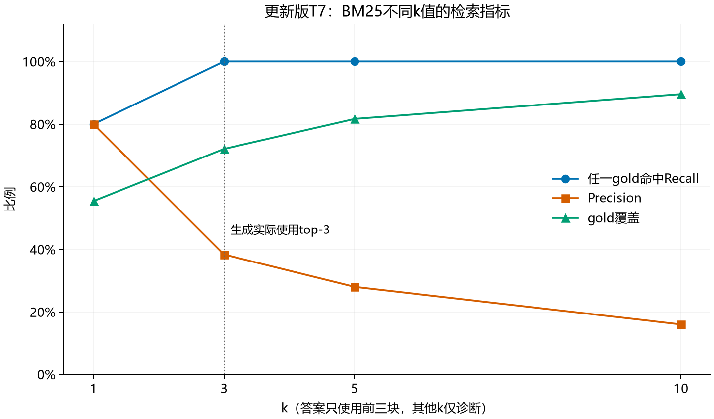
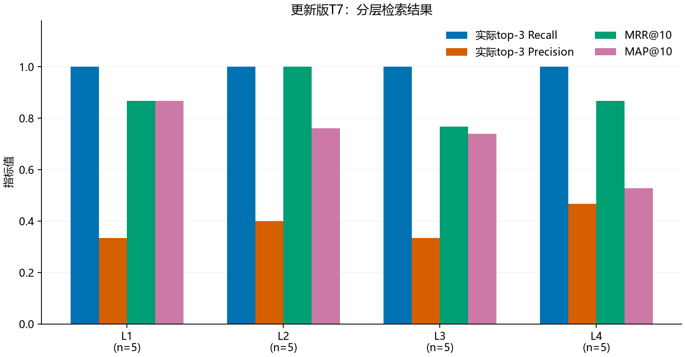
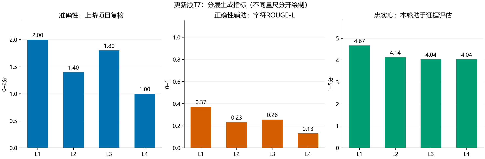
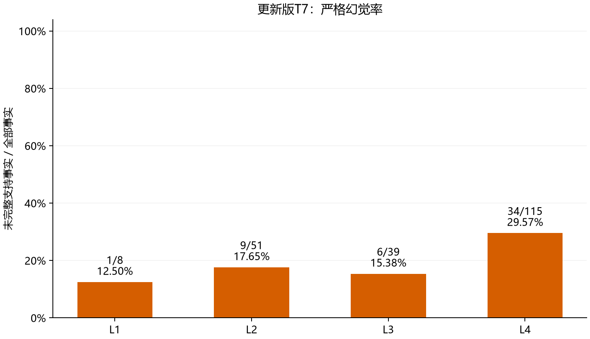
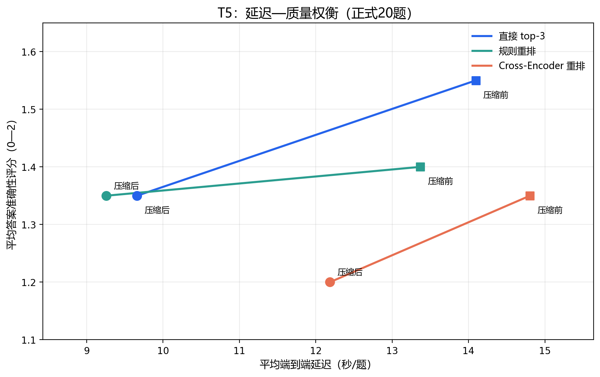

# T7系统评估报告（按T2/T4/T5更新）

## 评估对象与主要结论

本轮评估上游T4/T5选定的 **新版BM25候选top-5 → 直接取top-3 → 不压缩 → Qwen回答**。复用同学在2026-10-26实际生成并保存的20条回答；重新计算检索、正确性辅助指标，逐事实做本轮助手忠实度评估，不重新生成答案，也不沿用旧T7分数。

MRR=0.875、MAP=0.739；MRR@10=0.875、MAP@10=0.723。实际top-3的Recall=100.00%、Precision=0.383、标注gold平均覆盖=72.08%。Recall为100%仍不代表证据齐全。

字符ROUGE-L均值0.248、EM=0.00%；上游项目复核准确性1.550/2、引文支撑1.600/2，保留原量尺，不换成旧版0–5。本轮题均忠实度4.222/5；未完整支持事实50/213，严格幻觉率23.47%。

综合最弱的是 **L4**：上游准确性1.000/2、幻觉率29.57%。L3与L4忠实度都约4.04，差不足0.001，不按这个微小差值宣称某一级显著更差。

## 一、更新来源与系统选择

- 主分支/T2快照：`a3633858be398423ba731f35ff94ca939fd4955a`，T2已合并主分支。
- T4/T5快照：`18bb20be331e99fae83e009b638565d50056b705`，来源t4-t5-zhuxiangduo分支。源代码、结果和SHA256清单在upstream/及upstream_manifest.json中，未修改原文件。
- 正式评测集SHA256：`85d85050fd887da084c88094c4efcd799cffcc1819412fbea1df6490dc00178b`，L1–L4各5题，合计20题。
- 本轮生成模型摘要：`0edcdef34593eac1aa2be9c7d06c432dcf81945adca5eca2f27662c18f168ba0`。

T2做了12组分块检索实验；记录显示generated_answers=false，answer_correctness实际标为retrieval_evidence_proxy，不能当作真实生成答案准确性。T2中sliding_1024和small_to_big_1024的检索指标均为0.95，但T4/T5正式实验仍使用原650字符、重叠120的202块。评测口径也不同：T2优先用证据原文匹配，T4按gold片段ID。不能直接拼接成“采用T2最优分块后的T4/T5最终系统”。本轮评估真实存在的202块链路；若组内决定整合T2最佳分块，必须重建证据映射、生成新回答并另评。

T4新增BGE-small-zh-v1.5神经向量检索，结果如下（按上游保存的正式排名复算核对）：

| 方法 | Recall@1 | Recall@3 | Recall@5 | MRR@10 |
| --- | --- | --- | --- | --- |
| bm25 | 0.8 | 1.0 | 1.0 | 0.875 |
| dense | 0.45 | 0.8 | 0.95 | 0.6380555555555556 |
| hybrid | 0.6 | 0.95 | 1.0 | 0.7541666666666667 |

T4据Recall和首次命中排名选择BM25。T5在同一候选5上比较直接、规则、Cross-Encoder排序及压缩前后六组；上游准确性最高的是直接不压缩1.55/2，因此在新忠实度评分前就固定它为主评对象。选择与评估仍使用同一20题，不是独立留出验证；本报告不声称已经完成全小组所有模块的最终工程整合。

## 二、相对旧T7具体改变

|项目|旧T7|本轮更新|
|---|---|---|
|BM25实现|T3的单字加双字方案|T4 retrieval_compare.py的中文双字为主、查询词去重方案|
|最终Context|top-5|候选5直接取3、不压缩|
|生成预算|上下文8192，输出768|上下文16384，输出2048|
|真实回答来源|本地T3 rrf_0|同学T5 direct/False的20条回答|
|正确性|旧助手0–5量表|重算ROUGE-L/EM，保留上游0–2评分，不混量尺|
|忠实度与案例|针对旧回答的核验|针对新回答重新逐事实评估、重新选最差5题|

模型温度0.2、seed42，23篇语料和202块文本经比对保持一致。新版BM25排名已重算，并与T4保存的20题前10全部一致。T5中每题selected_chunk_ids等于新BM25前3，20题正文字符数均与记录一致。

**Context重建限制：**上游未直接保存完整Context字符串。本轮依据冻结代码的format_context、相同片段文本和实际selected_chunk_ids重建，并核对逐题正文字符数。token数采用上游记录，未另装tokenizer重算；不能把这说成与当时原始字符串作了直接逐字比对。重建的Context及SHA256随data/system_answers.jsonl保留。上游还未保存finish_reason；0/20条输出token达到2048上限，只能说未观察到token触上限，不能声称已独立证明零截断。

## 三、指标与评估方法

检索Recall@k按课程FAQ：任一标注gold片段进入前k记1；另报gold覆盖=命中gold数/全部gold数。Precision@k=前k标注相关数/k。MRR=首个相关片段排名倒数的题均值；AP=各相关命中位置Precision之和/该题全部gold数，MAP为AP题均值。全库指标用完整202排名，@10截断后仍把未命中gold保留在AP分母。

生成正确性重算字符级ROUGE-L F1与归一化EM；两者均与gold_answer对比。ROUGE-L反映文字重合，不是事实准确率；长建议、正确简答和参考答案的额外提醒都会影响它，EM为0也不意味着20题全错。上游准确性及引文支撑0–2仅为项目复核参考，未冒称独立人工标注，也没有线性放大成旧0–5。

忠实度由本对话Codex助手作为LLM逐事实评估：5=实际Context直接支持；4=结合题设可完整推导；3=仅部分支持或范围扩大；2=没有足够依据；1=与实际证据矛盾。每题事实均分，再按题平均。纯建议、学习目标、题设、标题、引用标号、纯拒答不计事实；混合建议中的政策、数据或官方来源归属断言仍计入。重复出现的事实按每次声明计数，无事实回答记N/A而不记满分。

严格幻觉率=未被实际Context完整支持的事实/全部事实，故3分部分支持也入分子。它不等于现实中一定错误，更不等于答错题目比例。微平均按事实数汇总，题均比例另存JSON；L4长回答对微平均权重更大。

证据判定仅以实际top-3和题设为依据，不拿全库或gold补足未召回证据。来源专用packet不含gold；但本对话助手了解任务与评测背景，**不冒称盲评或独立人工审核**。本轮未额外调用本地Qwen评分器。全部213项声明、分数、原句编号、真实证据原文和理由公开；所有回答单元均有事实/排除记录。助手语义判断与拆分仍需提交者复核，代码校验只能保证数据和引文一致，不能替代独立语义评价。

## 四、检索结果

| k | 任一gold Recall@k | Precision@k | 全部gold平均覆盖 |
| --- | --- | --- | --- |
| 1 | 80.00% | 0.800 | 55.42% |
| 3 | 100.00% | 0.383 | 72.08% |
| 5 | 100.00% | 0.280 | 81.67% |
| 10 | 100.00% | 0.160 | 89.58% |

答案实际只看top-3，k=5/10是诊断，不代表重新生成了这些k值的答案。严格gold编号没有穷尽重叠等价片段，MAP、Precision和覆盖可能低估有用证据；失败归因必须核对原文。例如q009虽缺某个辅修通知gold，实际仍有学籍规定中的部分等价制度，不能机械地把全部错误归为检索失败。

## 五、生成与L1–L4分层

| 等级 | 题数 | 上游准确性/2 | ROUGE-L | 忠实度/5 | 未支持/事实 | 幻觉率 |
| --- | --- | --- | --- | --- | --- | --- |
| L1 | 5 | 2.000 | 0.372 | 4.667 | 1/8 | 12.50% |
| L2 | 5 | 1.400 | 0.233 | 4.137 | 9/51 | 17.65% |
| L3 | 5 | 1.800 | 0.256 | 4.041 | 6/39 | 15.38% |
| L4 | 5 | 1.000 | 0.131 | 4.041 | 34/115 | 29.57% |

L4需要跨条款、跨业务及版本匹配，并区分政策事实与自主建议，错误最多。q006可在证据不足时谨慎拒答，因此忠实度不一定低，但没有完成10/15/差5的任务；q018长路线涵盖不少真实主题，却把自主练习归为官方路径。两例说明正确性和忠实度必须分开报告。

每层只有5题，L1一个错误条号就会显著影响事实比例；不能从这些比例推断普遍可靠性，也不做统计显著性结论。新旧T7配置、回答和评分量尺不同，不能把均分变化单独归因于BM25、top-k或某一模块。

## 六、最差五题归因

选题在忠实度评分前固定：上游准确性升序 → 上游引文分升序 → ROUGE-L升序 → 题号。详细原回答、gold、实际候选5/最终3、正确片段排名、字面证据及改进验证方案见《T7失败案例分析_更新版.md》。

| 题号 | 等级 | 上游准确性/2 | 主归因 |
| --- | --- | --- | --- |
| q016 | L4 | 0 | 生成失败 |
| q018 | L4 | 1 | 检索失败 |
| q020 | L4 | 1 | 检索失败 |
| q006 | L2 | 1 | 排序失败 |
| q019 | L4 | 1 | 检索失败 |

本轮候选池是5，不是旧T3的20；“排序失败”包括候选已有但直接取3时被截掉，并不意味着本主评配置实际启用了重排模型。全库事后定位的正确证据明确标注为未进入Context，绝不用于抬高忠实度。

## 七、系统效率与多模态边界

以下是同学T5正式六组运行的原始记录重算，**不是在本机新测速度**。主评组平均Context为1332.10 token，端到端14.09秒/题。原T5记录单独warmup约48.86秒，不能把它当某一题处理耗时。旧T3缓存计时不作直接对照。

| 排序 | 压缩 | Context token/题 | 端到端秒/题 | 任一证据@3 | 全部证据@3 |
| --- | --- | --- | --- | --- | --- |
| direct | False | 1332.10 | 14.09 | 1.0 | 0.5 |
| direct | True | 667.25 | 9.66 | 1.0 | 0.5 |
| model | False | 1354.40 | 14.81 | 0.9 | 0.5 |
| model | True | 669.85 | 12.19 | 0.9 | 0.5 |
| rule | False | 1309.10 | 13.37 | 0.95 | 0.55 |
| rule | True | 666.05 | 9.26 | 0.95 | 0.55 |

上游项目准确性均分：直接不压缩1.55/2，直接压缩1.35/2；规则不压缩1.40/2，模型不压缩1.35/2。因此压缩省token但有质量代价，重排也未获得整体质量收益。本轮据此选择直接不压缩，不为展示优化而默认堆叠模块。重排/压缩前后的片段ID可能不变，但删除关键句仍会损害答案，ID覆盖不能替代忠实度。

本次主评为文本链路。部分原资料源自PDF/表格，但进入检索的是转换后的Markdown，不代表已经验证图文混合检索、复杂表格或OCR准确性。q018跨页内容遗漏说明需要文档结构与续页覆盖；对未来多模态扩展，应保留表头、整行、页号和条款关系，再单设含图表的评测集。本报告没有虚构多模态性能指标。

## 八、交付、复现与局限

交付包括20题完整表（MD/CSV/JSON）、4张新图、213事实及证据、5个失败案例、上游版本快照、评分表和复现校验。README_T7更新版.md给出命令。复现是从固定源记录重算排名、Context、指标和公开判断表，不等于重新独立采样或重新生成20答案；改变系统后必须重新评。

主要限制：20题小样本、同评测集选配置与评估的偏乐观风险、上游正确性评分主观性、助手事实拆分与支持判断主观性、gold重叠标注不完备，以及原始Context/停止原因未直接保存。T2最佳分块和T3优化尚未构成一条经本轮运行验证的整合链路。旧T7保留为历史，不能与本轮混表。提交者应重点复核政策年份、年级、条号、数字、拒答和官方/建议边界。

课程验收依据为《检索增强生成-课程实践作业》T7：检索四类指标、生成三类指标、L1–L4柱状图及最差5题归因改进。来源为仓库固定提交和用户提供的任务要求；实现、逐事实评估及报告有大模型辅助，未冒称独立人工评审。
