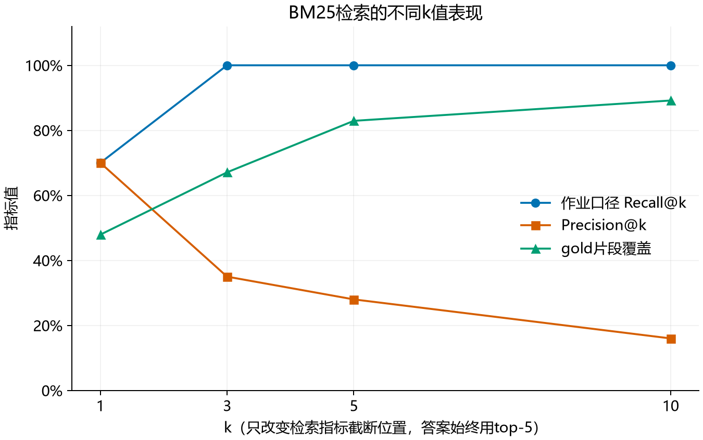
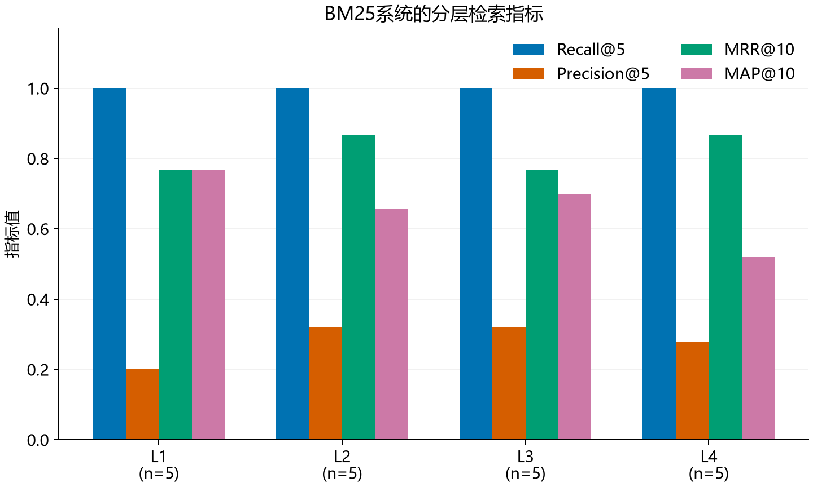
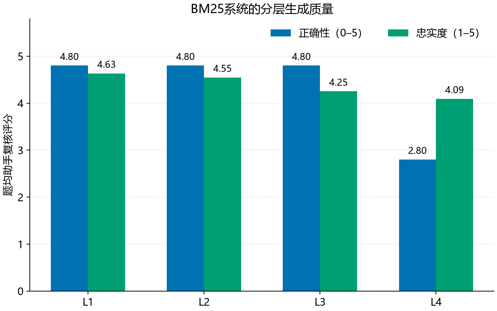
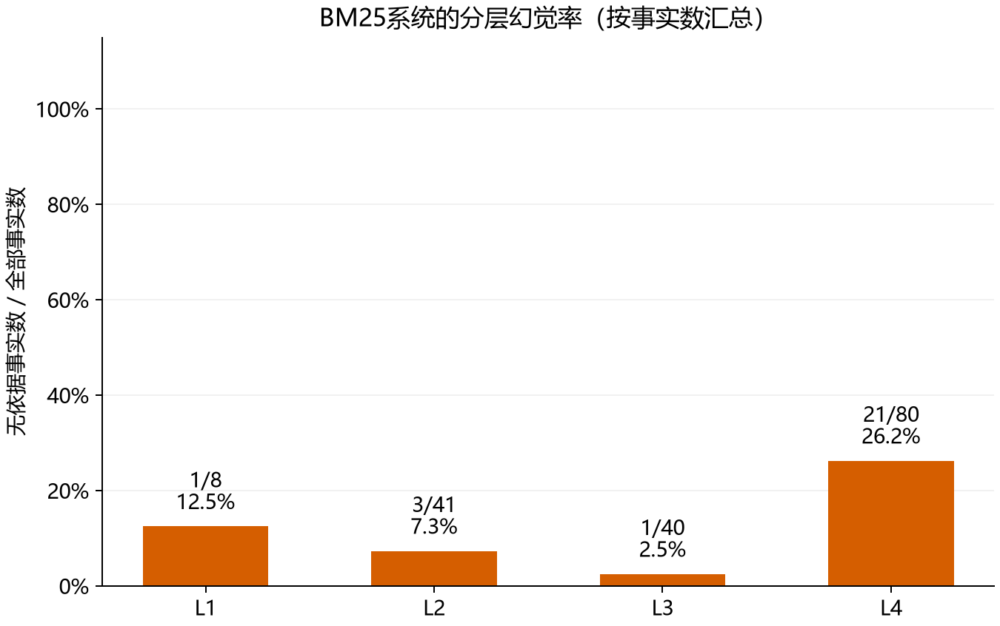

# T7 BM25系统完整评估报告

## 评估对象与结论

本任务对应课件9.5 p33–36。按用户明确选择，评估本地T3的BM25端点（α=0），不是擅自指定尚未整合的其他小组方案。对其已保存的20条真实回答、实际top-5 Context和固定202片段做离线评估，不重新生成答案。

该快照的MRR为0.817、MAP为0.669；MRR@10为0.817、MAP@10为0.660。Recall@5为100.0%，但只表示命中至少一块gold，不代表全部证据齐全或答案正确。

答案正确性助手量表复核均分4.300/5，题均忠实度4.381/5；严格无依据事实为26/169，微平均幻觉率15.4%。正确性最低的等级为L4，忠实度最低为L4，幻觉率最高为L4；这些维度分别反映回答任务完成度、证据支持强度和无依据事实比例。

## 数据与运行边界

- 使用原项目23篇资料、202片段，650字符切分、120字符重叠。20题L1–L4各5题，金标由原仓库助手辅助编制，仍需提交者独立核验。
- 系统检索为中文单字/双字及完整数字英文标识的BM25，k1=1.5，b=0.75，最终提供5个片段。
- 原回答由qwen3:4b-instruct生成，temperature=0.2、seed=42、上下文8192、输出上限768 token；本次不提高上限来掩盖失败。4/20条回答触及输出预算。
- 正确性重新按“单题问题＋参考答案＋实际回答”进行0–5分模型评分，20条新调用在correctness_new.jsonl中。但新评分仍出现引用编号误判，因此最终由助手按公开的逐题5分量表复核，得分为各子项实得分之和，详见correctness_reviewed.json。这是助手复核，不是独立人工评分；量表是在查看实际输出后制定，未预注册。旧T3均分4.350/5、新单题模型均分3.850/5均保留作评分敏感性对照，不混同最终量表分。字符ROUGE-L均值为0.251，仅作辅助。
- 忠实度先做模型逐句核验，再由助手对20条实际回答逐句复核并拆解事实、剔除题设与纯建议、核对条号年份。忠实度复核只使用实际召回片段、问题条件和待评答案，不使用gold_answer。最终统计来自faithfulness_reviewed.jsonl，明确属于助手复核，不是独立人类标注。原始模型记录完整保留。

## 指标口径

Recall@k按作业FAQ：某题任一gold片段进入前k即记1。另报标准gold覆盖比例。Precision@k=前k中标注相关片段数/k。MRR=首个gold排名倒数的题均值；AP=各gold命中位置的Precision均值，分母为该题所有标注gold数；MAP为AP题均值。全库指标使用完整BM25排名，@10版本截断前10，未命中的相关片段仍计入AP分母。

每个事实按1–5分：5直接支持；4可由片段与给定条件完整推导；3关键条件/范围仅部分支持；2未找到依据；1与证据矛盾。题内事实均分再按题平均得到忠实度。纯建议、假设、标题和纯拒答不进入事实分母；没有事实时指标为N/A，不记满分。

按作业的严格定义，未被当前Context完整支持（含部分支持、无依据、矛盾）的声明均计入幻觉分子。这不意味着它一定在现实中错误。微平均幻觉率是全体无依据事实数/全体事实数；题均比例另存在JSON中，不能混用两种平均。

17条“模型判有依据却漏填证据句号”的记录进行了单独证据定位复核。原始模型共提取222个事实并判95个未支持；证据定位后为82/222。逐句复核发现模型还会把标题扩写成事实、漏掉错误文号、把建议和题设计为幻觉，因此最终使用公开复核表的169个事实，未对原始答案或召回做改写。拆分粒度与分母变了，两组比率不能解释为系统性能提升。复核表生成器tools/build_reviewed_facts.py逐项列明原句编号、判断理由与真实证据句号，可由提交者继续检查。

## 检索模块结果

| k | 作业Recall@k | Precision@k | gold覆盖 |
| --- | --- | --- | --- |
| 1 | 70.0% | 0.700 | 47.9% |
| 3 | 100.0% | 0.350 | 67.1% |
| 5 | 100.0% | 0.280 | 82.9% |
| 10 | 100.0% | 0.160 | 89.2% |

严格gold编号未穷尽所有等价重叠片段，因此P@k、MAP和gold覆盖可能低估部分真实有用片段。归因时会检查原文，不能仅凭gold编号缺失判定检索失败。最终生成始终使用top-5，k曲线不代表重新生成了四组答案。

## 生成模块与分层结果

| 等级 | 题数 | MRR@10 | MAP@10 | 正确性/5 | 忠实度/5 | 无依据/事实 | 幻觉率 |
| --- | --- | --- | --- | --- | --- | --- | --- |
| L1 | 5 | 0.767 | 0.767 | 4.800 | 4.633 | 1/8 | 12.5% |
| L2 | 5 | 0.867 | 0.657 | 4.800 | 4.547 | 3/41 | 7.3% |
| L3 | 5 | 0.767 | 0.699 | 4.800 | 4.251 | 1/40 | 2.5% |
| L4 | 5 | 0.867 | 0.519 | 2.800 | 4.092 | 21/80 | 26.2% |

每级只有5题。长答案包含更多事实，因此微平均幻觉率对事实较多的问题权重更大；不能把它读成“有多少题答错”。截断同时影响完整性，正确但漏掉关键限制也会降低正确性。忠实度高的拒答不等于任务完成，必须结合正确性看。

## 最差五题与改进

按“正确性升序→忠实度升序→幻觉率降序→题号”固定规则选题，完整逐题复核见《T7失败案例分析.md》。

| 题号 | 等级 | 正确性 | 主归因 |
| --- | --- | --- | --- |
| q020 | L4 | 2.0/5 | 检索失败 |
| q019 | L4 | 2.0/5 | 排序失败 |
| q016 | L4 | 2.0/5 | 生成失败 |
| q012 | L3 | 4/5 | 生成失败 |
| q005 | L1 | 4/5 | 生成失败 |

归因区分：必要证据未进入候选20为检索失败；候选已找到却未进入top-5为排序失败；证据已经给出但回答错误、无依据扩展或被预算截断为生成失败；问题/金标或等价片段标注不清为评测集歧义。最后结论依据实际文本复核，不机械使用上述编号启发式。改进方案是下一轮可验证的建议，不冒称已完成改造。

系统效率方面，本次没有把跨条件缓存复用的旧计时冒充新延迟基准；仅报告真实token数和截断情况。多模态扩展性没有在纯文本快照上测试；无法据此推断图片、复杂表格或OCR的处理能力。

## 复现与局限

完整20题表见《T7完整评估表.md》，逐原子事实及证据在results/t7/claim_evaluations.json。运行命令、固定输入和模块对应关系见README_T7.md。5项指标/证据检查已通过，源代码和数据摘要随包保存。

主要局限为20题小样本、同模型生成与自评偏差、助手事后制定的正确性量表及事实拆分和支持判断的主观性、金标重叠片段不完备及原输出预算截断。助手做了全部回答的证据复核及失败案例分析，不冒称教师或其他独立人工审核；引用句号真实存在也不自动保证语义蕴含正确。最终正确性属于助手量表评估；建议提交者重点复核低分和政策细节。报告不声称显著性、生产可靠性或其他版本同样表现。

## 方法与来源

- 课程实践作业T7及课件9.5为验收依据，主评对象由用户明确选择。
- 检索指标：[Stanford IR教材](https://nlp.stanford.edu/IR-book/html/htmledition/evaluation-of-ranked-retrieval-results-1.html)。
- 原子事实与Context一致性的思路参考[Ragas Faithfulness](https://docs.ragas.io/en/latest/concepts/metrics/available_metrics/faithfulness/)。本实现按课程使用1–5分，并未直接运行Ragas包，不能把分数当作其官方0–1指标。
- 基础项目及评测数据来源sunfeiyu666/LLM-RAG与本地T3快照；新增评估与报告有大模型辅助，模型调用真实发生，结果未编造。
